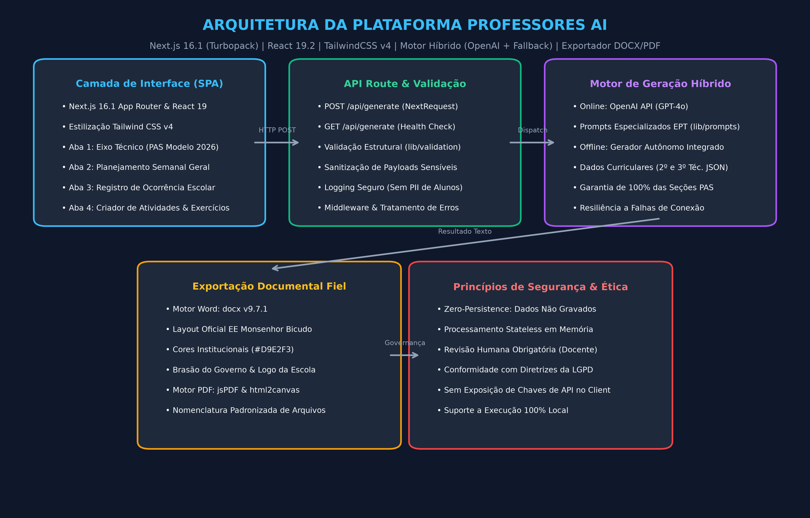
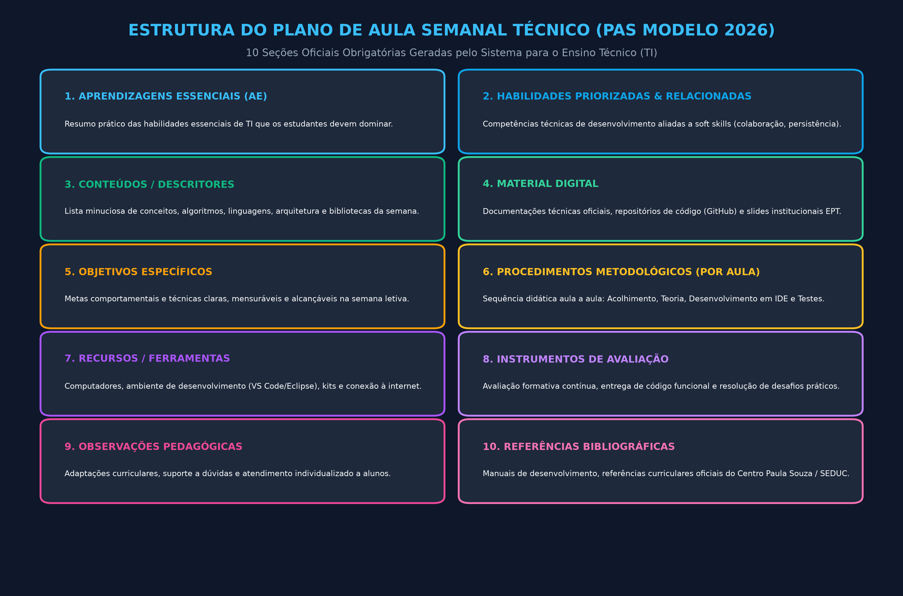

# Professores AI — Assistente Pedagógico Inteligente para Docentes do Ensino Técnico e Básico

## 1. Visão Geral

O **Professores AI** é uma plataforma web desenvolvida para otimizar a rotina de professores e coordenadores pedagógicos, particularmente na Educação Profissional e Tecnológica (EPT) e no Ensino Médio. O sistema automatiza a elaboração de **Planos de Aula Semanais (PAS)** no formato oficial exigido pela rede pública paulista (baseado no padrão da EE Monsenhor Bicudo), auxilia na redação formal e ética de **ocorrências escolares** e estrutura **atividades didáticas**, oferecendo exportação com fidelidade visual completa para arquivos **Word (.docx)** e **PDF**.

Com uma abordagem *privacy-first*, o sistema opera de forma estritamente *stateless*, não persistindo dados pessoais ou acadêmicos de estudantes, e disponibiliza um **motor de fallback offline autônomo** que assegura geração contínua de planos pedagógicos mesmo sem conexão ativa ou chave da OpenAI configurada.

---

## 2. Arquitetura do Sistema

A aplicação foi desenvolvida sobre o ecossistema moderno do Next.js com foco em desempenho, modularidade e responsividade:

```
[ Frontend SPA (Next.js 16.1 App Router + React 19.2 + TailwindCSS v4) ]
  ├── Aba Início: Visão geral e atalhos rápidos
  ├── Aba Eixo Técnico: Geração de Planos PAS Modelo 2026 (TI / EPT)
  ├── Aba Planejamento: Estruturação curricular para a Educação Básica
  ├── Aba Ocorrências: Redação técnica e neutra de eventos disciplinares
  └── Aba Atividades: Criação de dinâmicas, desafios e listas de exercícios
            │
            │ HTTP POST /api/generate
            ▼
[ Camada de Roteamento & Validação (NextRequest / NextResponse) ]
  ├── Validador de Payloads (lib/validation.ts)
  └── Sanitização & Logging Seguro (Sem PII de alunos)
            │
            ├─── Motor Online ───▶ [ OpenAI API (GPT-4o) ]
            │                         └── Prompt Engineering Pedagógico Especializado
            │
            └─── Motor Offline ──▶ [ Fallback Pedagógico Autônomo ]
                                      ├── Matriz Curricular (lib/data/2_ano_tec.json)
                                      ├── Matriz Curricular (lib/data/3_ano_tec.json)
                                      └── 100% de Conformidade com as 10 Seções PAS
            │
[ Pipeline de Exportação Fiel ]
  ├── Gerador Word DOCX (docx v9.7.1): Layout oficial com brasão, logo e tabelas #D9E2F3
  └── Gerador PDF (jsPDF + html2canvas): Captura vetorial para impressão
```



---

## 3. Conformidade com o Modelo Oficial de Ensino Técnico (PAS 2026)

O assistente foi calibrado para gerar 100% das 10 seções regulamentares do modelo institucional **PAS_MODELO_2026**:

1. **Aprendizagens Essenciais (AE)**: Domínio prático e conceitual da competência.
2. **Habilidades Priorizadas e Relacionadas**: Habilidades técnicas articuladas a competências socioemocionais.
3. **Conteúdos / Descritores**: Relação detalhada de tópicos, sintaxes, arquiteturas e algoritmos trabalhados.
4. **Material Digital**: Documentações oficiais, repositórios GitHub e plataformas educacionais.
5. **Objetivos Específicos**: Metas semanais operacionais e mensuráveis.
6. **Estratégias / Procedimentos Metodológicos**: Roteiro detalhado aula a aula (Aulas 1 a 4).
7. **Recursos / Ferramentas**: IDEs, computadores de laboratório técnico e ferramentas de teste.
8. **Avaliação**: Critérios formativos contínuos e evidências de entrega prática de código.
9. **Observações**: Adaptações pedagógicas e suporte a necessidades específicas.
10. **Referências Bibliográficas**: Manuais de engenharia de software e diretrizes curriculares oficiais.



---

## 4. Validação Real e Testes Executados

O projeto foi executado e testado integralmente em ambiente real:

1. **Instalação de Dependências**: 403 pacotes NPM instalados com sucesso sob Node.js v20.20.2.
2. **Compilação de Produção**: Build executado via `next build` com compilador Turbopack gerando bundles otimizados em 11.0s (rotas estáticas `/` e dinâmica `/api/generate`).
3. **Execução do Servidor de Produção**: Servidor Next.js inicializado em `http://localhost:3000` (pronto em 1.74s).
4. **Testes Funcionais de API**:
   - `GET /`: Status `HTTP 200 OK` (renderização de HTML de 15.7 KB).
   - `GET /api/generate`: Health check respondendo `503 unavailable` na ausência de chave OpenAI em produção (ativando fallback).
   - `POST /api/generate`: Status `HTTP 200 OK` utilizando o motor de fallback do Eixo Técnico, gerando plano com 1.602 caracteres e validação positiva de presença de **todas as 10 seções oficiais**.

Evidência autêntica gravada em: [`evidencias/log_execucao_real.txt`](evidencias/log_execucao_real.txt).

---

## 5. Instruções de Execução

### Pré-requisitos
- Node.js 18+ (testado e validado em Node 20.20.2)
- Chave OpenAI (`OPENAI_API_KEY`) opcional para o fluxo online

### Instalação e Execução
```bash
# 1. Instalar dependências
npm install

# 2. Configurar variável de ambiente (opcional para IA online)
# Crie o arquivo .env.local:
OPENAI_API_KEY=sua_chave_aqui

# 3. Executar em modo desenvolvimento
npm run dev

# 4. Compilar e rodar em produção
npm run build
npm run start
```
Acesse a aplicação em `http://localhost:3000`.
